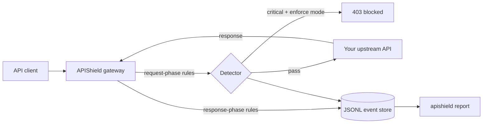

# APIShield

**An API security gateway that sits in front of your API and catches the attacks that actually breach APIs** — BOLA/IDOR, broken JWTs, credential stuffing, sensitive-data exposure and missing security headers — in real time, with zero runtime dependencies.


Most API breaches are not exotic zero-days. They are the same five mistakes, repeated: an object id swapped in a URL (BOLA), an `alg=none` token a verifier should never have accepted, a login endpoint absorbing a stuffing burst, a response quietly leaking card numbers, a production API with no security headers. APIShield watches for exactly those patterns in live traffic — first in **monitor mode** (log everything, block nothing, learn your baseline), then in **enforce mode** (critical rules block with a 403 before the request ever reaches your backend).

## Why APIShield

- **Zero dependencies.** Pure Python 3.11+ standard library — the proxy core is `http.server` + `http.client`. Nothing to supply-chain-audit, nothing to break.
- **Identity-aware, not just IP-aware.** Principals are extracted from the JWT `sub` claim, an API-key fingerprint or a user-id header, so cross-user object access (BOLA) is detectable at all — a plain rate limiter cannot see it.
- **Evidence without secrets.** Every event carries redacted evidence (truncated value + SHA-256 fingerprint). Raw tokens, passwords and card numbers never touch the event log — there is a test that proves it.
- **Deterministic rules.** No ML black box. Every alert names the exact pattern that fired, so triage takes seconds.
- **Five-minute deployment.** One JSON config, one process, or one `docker compose up`.

## Architecture



Request-phase rules (BOLA, JWT, auth abuse) run **before** forwarding — that is what makes blocking possible. Response-phase rules (data exposure, security headers) run on the way back. State is deliberately small: an object-ownership map and two sliding windows, all in-process.

## Rule catalogue

| Rule | Phase | Severity | What it catches |
|---|---|---|---|
| `bola.cross_principal_access` | request | critical | An object (numeric/UUID path segment, or `*_id` query param) first seen under one principal is requested by a different principal |
| `bola.sequential_probing` | request | high | One principal sweeping many distinct numeric ids on one resource in a short window |
| `jwt.alg_none` | request | critical | `alg=none`, unknown alg, or an empty signature segment |
| `jwt.token_in_query` | request | high | JWT-shaped token in a query string (URLs get logged and cached) |
| `jwt.missing_exp` / `jwt.expired` / `jwt.malformed` | request | medium | Tokens that never expire, expired tokens still being presented, non-JWT bearer values |
| `auth_abuse.rate_anomaly` | request | high → critical | Requests to auth paths (`/login`, `/auth`, `/token`, `/oauth`) from one IP exceeding the configured window limit; escalates to critical (blocking) at 2× the limit |
| `data_exposure.email_addresses` | response | medium | Email addresses in response bodies |
| `data_exposure.card_number` | response | high | Luhn-valid card-like numbers in response bodies |
| `data_exposure.api_key` / `data_exposure.jwt` / `data_exposure.generic_secret_field` | response | high | API-key shapes, JWTs and secret fields leaking in responses |
| `security_headers.missing` | response | low | Missing `Strict-Transport-Security`, `Content-Security-Policy`, `X-Content-Type-Options` (or not `nosniff`), `X-Frame-Options` |

## Quickstart

### Local

```bash
pip install .

# 1. point APIShield at your API
cat > apishield.json <<'EOF'
{
  "upstream": "http://127.0.0.1:9000",
  "listen_port": 8080,
  "mode": "monitor"
}
EOF

# 2. run it — clients now call :8080 instead of :9000
apishield run --config apishield.json

# 3. see what it caught
apishield report --log apishield-events.jsonl
```

### Docker

```bash
docker compose up --build
# starts the bundled (deliberately vulnerable) demo upstream on :9000
# behind APIShield on :8080 — then run the demo against it
```

## Demo

APIShield ships with a tiny, intentionally vulnerable demo API (no authorisation checks, leaks emails and a test card number, accepts any login) plus a scripted attack replay:

```bash
apishield demo
```

```
--- APIShield demo (mode: enforce) ---
[ok]     Alice reads her own profile        -> HTTP 200
[attack] Bob reads Alice's profile (IDOR)   -> BLOCKED
[attack] alg=none JWT presented             -> BLOCKED
[attack] credential-stuffing burst x12      -> BLOCKED
```

The replay runs in both modes: monitor logs every attack and lets it through; enforce blocks the cross-user IDOR read, the `alg=none` token and the stuffing burst, while Alice's legitimate traffic passes untouched.

## Configuration

One JSON file. Every field is optional except, realistically, `upstream`.

| Key | Default | Meaning |
|---|---|---|
| `upstream` | `http://127.0.0.1:9000` | Base URL of the API being protected |
| `listen_host` / `listen_port` | `127.0.0.1` / `8080` | Where APIShield listens |
| `mode` | `monitor` | `monitor` = log only · `enforce` = block on critical rules |
| `event_log` | `apishield-events.jsonl` | JSONL event store path |
| `rules` | all `true` | Per-rule toggles: `bola`, `jwt`, `auth_abuse`, `data_exposure`, `security_headers` |
| `thresholds.auth_requests_per_window` | `20` | Auth-path requests per window per (IP, path) |
| `thresholds.auth_window_seconds` | `60` | Auth-abuse window |
| `thresholds.probe_distinct_ids_per_window` | `10` | Distinct ids before probing fires |
| `thresholds.probe_window_seconds` | `60` | Probing window |
| `thresholds.auth_paths` | `/login /auth /token /oauth` | Path prefixes treated as auth endpoints |
| `max_scan_bytes` | `1000000` | Response bodies larger than this skip data-exposure scanning |

Unknown keys, bad values and out-of-range numbers are rejected at startup with a specific error — a gateway should fail loudly, not silently mis-protect.

## Report

```text
$ apishield report
APIShield event report
============================================================
total events : 26
blocked      : 0

by rule:
  security_headers.missing               15
  data_exposure.email_addresses          3
  data_exposure.card_number              3
  bola.cross_principal_access            2
  auth_abuse.rate_anomaly                2
  jwt.alg_none                           1
```

Add `--json` for machine-readable output.

## Limitations — honestly

- **Heuristics, not magic.** BOLA detection infers object ownership from observed traffic: the first principal seen touching an object is treated as its owner. Shared/legitimately public objects can false-positive until a baseline exists, and an attacker who is *first* to an object looks like its owner. Run monitor mode first and review before enforcing.
- **No signature verification.** APIShield inspects JWT structure and claims; verifying signatures remains the upstream's job (a gateway that can't see your keys shouldn't pretend to verify).
- **In-process state.** Ownership maps and rate windows live in memory and reset on restart; a single gateway instance is the unit of consistency. Multi-instance deployments need a shared store (roadmap).
- **Plain HTTP core.** Terminate TLS in front of APIShield (or behind your existing ingress); the gateway itself speaks HTTP/1.1 and does not do HTTP/2 or WebSockets yet.
- **Data-exposure scanning is pattern-based** on bodies up to `max_scan_bytes` of text-like content — it catches shapes (emails, Luhn-valid numbers, key formats), not semantics.

## Roadmap

- Shared state backend (Redis/SQLite) for multi-instance deployments
- Per-route rule profiles and allowlists for known-public objects
- OpenAPI-spec-aware mode: validate traffic against your own API contract
- Prometheus metrics endpoint and a small live dashboard
- WebSocket and HTTP/2 support

## Development

```bash
pip install -e . pytest
python -m pytest        # 59 tests: rules, gateway, redaction, config, report, demo
python -m apishield.cli demo
```

## License

MIT — © 2026 Priyanshu Kumar Thakur. See [LICENSE](LICENSE).
